<div align="center">



### `johnny4young` &nbsp;·&nbsp; Johnny IV Young Ospino

[](https://nodejs.org)
[](https://www.typescriptlang.org)
[](https://golang.org)
[](https://swift.org)
[](#-tech-stack)

[](https://github.com/johnny4young?tab=followers)
[](https://github.com/johnny4young)

</div>

---

## About

**Backend engineer** specialized in **Node.js**, **TypeScript**, and **Go**, with deep focus on **distributed systems**, **developer tooling**, and **production-grade LLM applications** — plus a growing line of **native Apple apps in Swift** (macOS · iOS · iPadOS).

I design APIs and platforms that survive real traffic — clean boundaries, strong observability, and the kind of architecture that lets teams ship fast without breaking things. Lately, much of my work sits where **backend engineering meets AI**: agent workflows, MCP servers, retrieval pipelines, and on-device models wired into **local-first products** that keep your data on your machine.

> Pragmatism over hype. Fewer abstractions over clever ones. Tools that get out of the developer's way.

---

## 🚀 Flagship Projects

<table>
<tr>
<td width="50%" valign="top">

### 📋 [Gancho](https://github.com/johnny4young/gancho)
**Smart Clipboard for the Apple ecosystem**

Local-first clipboard history + curated snippet library for Mac, iPhone & iPad. GRDB/SQLite with FTS5 search (exact · fuzzy · regex), a floating ⇧⌘V panel with paste-back, pins & boards, free on-device OCR, and on-device intelligence — *Ask your clipboard*, Smart Paste, semantic auto-boards. Serverless iCloud sync via `CKSyncEngine`, plus a `gancho` CLI and opt-in local MCP server. **Private by design** — your data never leaves your devices.


[](https://gancho.app)
[](https://github.com/johnny4young/gancho/releases/latest)
[](https://github.com/johnny4young/gancho)

</td>
<td width="50%" valign="top">

### 🎙️ [Portavoz](https://github.com/johnny4young/portavoz)
**Privacy-first meeting assistant for Mac**

Records and transcribes meetings live and tells apart every voice — including yours — entirely on-device: Parakeet on the Neural Engine for live captions, Whisper for the refine pass, local diarization, and bilingual summaries via Apple Intelligence, Ollama, or a built-in model. ⌘K *Ask your week* with cited answers, action items → GitHub/Linear issues, and a local MCP server so your AI tools can ask *"what did I agree to yesterday?"* Shipping, signed and self-updating.


[](https://portavoz.app)
[](https://github.com/johnny4young/portavoz/releases/latest)
[](https://github.com/johnny4young/portavoz)

</td>
</tr>
<tr>
<td width="50%" valign="top">

### 🧠 [Lingua](https://github.com/johnny4young/lingua)
**Multi-language desktop code runner**

JavaScript, TypeScript, Python, Go, Rust, and Ruby in one offline-first, Monaco-powered app. The multi-language answer to RunJS: the same "open, write, run" ergonomics, with Go, Rust, Python, and Ruby as first-class citizens. Ships as a signed desktop app (macOS · Windows · Linux), an in-browser build powered by Pyodide and ruby.wasm, and a headless `lingua` CLI. Source-available commercial product.


[](https://linguacode.dev)
[](https://app.linguacode.dev)
[](https://github.com/johnny4young/lingua/releases/latest)
[](https://github.com/johnny4young/lingua)

</td>
<td width="50%" valign="top">

### 🛒 [Puntovivo](https://github.com/johnny4young/puntovivo)
**Local-first, fiscal-native POS**

A POS for Latin American retail — first wedge is Colombia retail for 1–10 site stores. One React app across Electron desktop and browser over an embedded Fastify + tRPC API, with an encrypted local SQLite database as the source of truth, so the store keeps selling when the network doesn't. Barcode-first checkout, cash sessions with blind close, site-owned stock with FEFO lots, DIAN-ready fiscal documents with a durable outbox, and audit logs throughout.


[](https://puntovivo.app)
[](https://github.com/johnny4young/puntovivo/releases/latest)
[](https://github.com/johnny4young/puntovivo)

</td>
</tr>
<tr>
<td width="50%" valign="top">

### 🤖 [Janusly](https://github.com/johnny4young/janusly)
**AI operator for business workflows**

Design, run, recover, and operate workflows from **one Go executable**: an embedded React control plane, PostgreSQL 18 as the durable queue, and OpenTelemetry built in. AI is part of the loop, not glued on top — Claude-backed workflow generation, run explanations, and semantic failure recovery, each with a deterministic fallback and human approval before anything mutates. Speaks **MCP both ways**: workflows consume external MCP tools, and agents can inspect and operate Janusly through its own MCP server.


[](https://janusly.app)
[](https://github.com/johnny4young/janusly)

</td>
<td width="50%" valign="top">

### 🖼️ [Vitrine](https://github.com/johnny4young/vitrine)
**Turn code — and your terminal — into beautiful images**

A native macOS menu-bar app that renders code, terminal output, images, URLs, and pasted HTML as share-ready images. `vgrab htop` replays full-screen terminal apps (htop, lazygit, nvim, k9s) through a cell-buffer emulator and captures the final frame — not a transcript of escape codes. Copy → retina PNG on your clipboard. Fully local, no account, MIT-licensed with an optional PRO tier.


[](https://vitrineframe.app)
[](https://github.com/johnny4young/vitrine/releases/latest)
[](https://github.com/johnny4young/vitrine)

</td>
</tr>
</table>

<details>
<summary><b>🍺 Install the apps and CLIs with Homebrew</b></summary>

```bash
brew tap johnny4young/tap

# macOS apps
brew install --cask gancho portavoz lingua vitrine

# CLIs (macOS + Linux)
brew install gos lingua-cli
```

</details>

---

## 🧰 More Open Source

- 🎭 **[electron-stagewright](https://github.com/electron-stagewright/electron-stagewright)** — Agentic UX testing for real Electron apps: drive them the way Playwright drives browsers, through an **MCP server built agent-first** for Claude Code, Codex, Cursor, and Cline. Semantic accessibility-tree queries, retrying `expect_*` primitives, snapshot diffs, session traces with deterministic replay and per-tool token budgets, and validation of signed, notarized `.app` bundles. &nbsp;   [](https://www.npmjs.com/package/@electron-stagewright/core) [](https://electron-stagewright.github.io/electron-stagewright/) [](https://github.com/electron-stagewright/electron-stagewright)
- 🐹 **[gos](https://github.com/johnny4young/gos)** — Install and switch Go versions in seconds. One Bash script, zero dependencies, checksum-verified downloads from go.dev, side-by-side versions, and a `gos doctor` that understands `GOTOOLCHAIN`. macOS · Linux · Windows · BSD. &nbsp;  [](https://github.com/johnny4young/gos/releases/latest) [](https://github.com/johnny4young/gos)
- 🍺 **[homebrew-tap](https://github.com/johnny4young/homebrew-tap)** — One tap for everything above: casks for Gancho, Portavoz, Lingua, and Vitrine, plus the `gos` and `lingua-cli` formulae. &nbsp; 

---

## 🔒 In the Lab *(private)*

- 🗣️ **herdr-portavoz** — *Talk to your agents.* On-device voice routing for [herdr](https://herdr.dev) coding agents: say *"codex: add tests for the parser"* and the prompt lands in the right agent pane. Answer blocked agents by voice, queue prompts for busy ones, and get optional spoken alerts when an agent finishes — powered by [Portavoz](https://github.com/johnny4young/portavoz)'s private English/Spanish speech-to-text, with nothing leaving your Mac. *Design stage.* &nbsp;  

---

## 🤝 Contract & Client Work

- High-throughput **Node.js / NestJS** APIs and queue-driven workers with strong observability.
- **Go** microservices where concurrency, latency, and footprint actually matter.
- Production **LLM systems** — Claude / OpenAI agents with tool use, structured outputs, and grounded retrieval.
- Internal **developer tooling** — CLIs, scripts, and platform glue that compresses friction across engineering teams.

---

## 🛠️ Tech Stack

**Languages**


**Backend & APIs**


**Apps & Frontend**


**AI & LLM Engineering**


**Data, Infra & Observability**


---

## 🧭 How I Build

- **Boring tech, sharp execution.** Pick proven tools. Spend the novelty budget where it actually matters.
- **Observability is not optional.** If you can't see it in production, you don't own it.
- **Small interfaces, composable parts.** Most complexity comes from premature abstractions, not missing ones.
- **Type the boundaries.** TypeScript, Go, and Swift aren't religions — they're contracts that catch bugs before users do.
- **AI is a system, not a prompt.** Real LLM apps live or die by retrieval, evals, guardrails, and observability — not the model name.
- **Ship, then sharpen.** A merged PR teaches more than a perfect plan.

---

## 📊 GitHub Stats

<div align="center">


</div>

---

<div align="center">


<sub>Built for engineers who'd rather ship than manage installations.</sub>

</div>
