### Local-first tools with Spanish names, built in Medellín.

[X / Twitter](https://x.com/johnny4young) &nbsp;·&nbsp; [Homebrew tap](https://github.com/johnny4young/homebrew-tap) &nbsp;·&nbsp; [electron-stagewright](https://github.com/electron-stagewright)

I'm Johnny, a senior backend and AI engineer working in **TypeScript, Go, and Swift**. For clients I build APIs and LLM systems that run in production. On my own time I build the tools below. They run on your machine, keep your data there, and most carry a Spanish name that says what they do.

## Mac apps, private by design

| Project | What it does | Latest |
| --- | --- | --- |
| **[Gancho](https://github.com/johnny4young/gancho)** · *hook* [gancho.app](https://gancho.app) | Clipboard history and snippet library for Mac, iPhone, and iPad. Full-text search, on-device OCR, and questions answered from what you copied. Syncs through your own iCloud. |  |
| **[Portavoz](https://github.com/johnny4young/portavoz)** · *spokesperson* [portavoz.app](https://portavoz.app) | Meeting assistant that knows who said what. Live transcription, speaker separation, and bilingual summaries, all on your Mac. A local MCP server lets your AI tools ask what you agreed to. |  |
| **[Secreteo](https://github.com/johnny4young/secreteo)** · *whispering* | Dictation from the menu bar. Hold a key, speak, and the text lands where your cursor is. Speech recognition runs on your Mac. |  |
| **[Vitrine](https://github.com/johnny4young/vitrine)** [vitrineframe.app](https://vitrineframe.app) | Turns code and terminal output into share-ready images. `vgrab htop` captures a full-screen terminal app as the frame you saw, not a transcript of escape codes. |  |

Swift 6 · SwiftUI · GRDB/SQLite · Core ML · CloudKit

## Developer tools

| Project | What it does | Latest |
| --- | --- | --- |
| **[Lingua](https://github.com/johnny4young/lingua)** [linguacode.dev](https://linguacode.dev) · [try it in the browser](https://app.linguacode.dev) | Offline-first code runner and scratchpad for JavaScript, TypeScript, Python, Go, Rust, Ruby, and SQL. Inline results, a debugger, an HTTP client, a database client, and notebooks in one app for macOS, Windows, Linux, and the web. |  |
| **[gos](https://github.com/johnny4young/gos)** | Installs and switches Go versions in seconds. One Bash script, no dependencies, checksum-verified downloads. macOS, Linux, Windows, and BSD. |  |

TypeScript · Electron · React · Monaco · DuckDB · Bash

## For AI agents

| Project | What it does | Latest |
| --- | --- | --- |
| **[electron-stagewright](https://github.com/electron-stagewright/electron-stagewright)** [docs](https://electron-stagewright.github.io/electron-stagewright/) | Lets coding agents drive real Electron apps the way Playwright drives browsers. An MCP server with accessibility-tree queries, retrying assertions, and replayable session traces. |  |
| **[Relevo](https://github.com/johnny4young/herdr-relevo)** · *relay* | A [Herdr](https://herdr.dev) layout for running coding agents across several Claude accounts. One inbox answers "whose turn is it?" across agents, pull requests, and reviews. |  |
| **[Janusly](https://github.com/johnny4young/janusly)** [janusly.app](https://janusly.app) | AI operator for business workflows in one Go executable. Designs, runs, and recovers workflows on PostgreSQL, with human approval before anything changes. MCP client and server. | In development |

TypeScript · Go · PostgreSQL · MCP · Claude · OpenTelemetry

## For business

| Project | What it does | Latest |
| --- | --- | --- |
| **[Puntovivo](https://github.com/johnny4young/puntovivo)** [puntovivo.app](https://puntovivo.app) | Point of sale for Latin American retail, starting with Colombia. The store keeps selling offline: checkout, cash sessions, per-site stock, and fiscal documents run on an encrypted local database. |  |

TypeScript · Electron · React · Fastify · tRPC · SQLite

## Install

The Mac apps and CLIs install with Homebrew. The current casks, formulae, and versions are in the **[homebrew-tap](https://github.com/johnny4young/homebrew-tap)**.

## In the lab

- **MeloSensei** *(private)*: a piano coach for iPad. You play short pieces on your own keyboard; it listens over MIDI and gives one correction at a time.
- **herdr-secreteo** *(private)*: voice routing for Herdr agents on top of Secreteo's dictation. Say "codex: add tests for the parser" and the prompt reaches the right agent. The offline router works; live delivery does not exist yet.
- **VetCare** *(private)*: clinic management for veterinary practices. Reception and scheduling, medical records, hospital, pharmacy and cash register, grooming, and a portal for pet owners. React and TypeScript on the web, Spring Boot behind it.
- **[local-model-store](https://github.com/johnny4young/local-model-store)**: one verified on-disk store for local AI models, so a model downloads once even when several of my apps need it.

## Client work

- Node.js and NestJS APIs and queue workers that hold up under real traffic.
- Go services where concurrency, latency, and footprint matter.
- LLM systems with tool use, structured outputs, and retrieval, built to be observed and evaluated.

## How I build

- **Local first.** Your data stays on your device unless you choose otherwise.
- **Boring tech, sharp execution.** Proven tools, with novelty spent where it matters.
- **AI is a system, not a prompt.** Retrieval, evals, guardrails, and a deterministic fallback.

